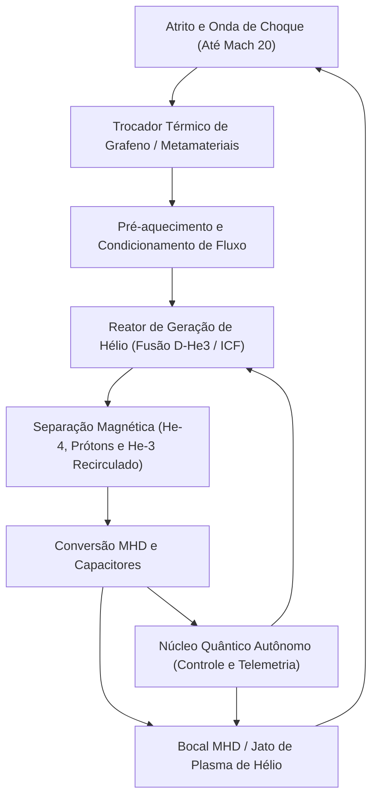

# SOGH

# Infraestrutura de Sistemas — ADEQ Classe Borealis & SOGH Classe Vórtice

Documentação técnica e arquitetural do ecossistema utópico e futurista de plataformas aeroespaciais e orbitais-suborbitais, integrando **computação quântica**, **termodinâmica de alta eficiência**, **fusão por ignição a laser (ICF)**, **propulsão magnetohidrodinâmica (MHD)** e **retroalimentação por geração de Hélio**.

---

## 1. Visão Geral da Infraestrutura

O projeto é dividido em duas plataformas complementares:

1. **ADEQ – Classe Borealis (*Aeronave de Domínio Estratégico Quântico*):**
   - Plataforma supersônica/hipersônica tripulada por **4 especialistas** ($\approx 45\text{ m}$ de envergadura).
   - Opera como supercomputador quântico voador com **Núcleo Cognitivo Quântico (NCQ)**, sistema **Waterfall** de nanofluido dielétrico, circuito criogênico de **Hélio-3** ($0,01\text{ K}$) e ignição **ICF** sob demanda.

  
2. **SOGH – Classe Vórtice (*Satélite/Veículo Orbital-Suborbital Autônomo de Propulsão por Geração de Hélio*):**
   - Versão **não tripulada** para órbita terrestre muito baixa (VLEO), transição suborbital/orbital e missões interplanetárias (como trânsito Terra–Marte).
   - Projetado para atingir até **Mach 20** ($\approx 6,8\text{ km/s}$), com **retroalimentação termo-energética** contínua, **geração e recirculação de Hélio**, armazenamento expansível e controle autônomo por IA quântica.
  


---

## 2. Arquitetura de Subsistemas (ADEQ – Classe Borealis)

### 2.1 Escala e Cabine de Comando (4 Tripulantes)
- **Estrutura:** Fuselagem de compósitos de grafeno e metamateriais autorregenerativos.
- **Interfaces:** Cabine sem botões físicos, baseada em interfaces neurais e projeção holográfica 3D.
- **Funções da Tripulação:**
  1. **Comandante de Voo e Tática:** Decisões estratégicas apoiadas por hologramas 3D do campo de batalha em tempo real.
  2. **Arquiteto de Sistemas Quânticos:** Coerência dos *qubits*, integridade do *Waterfall* e alocação computacional.
  3. **Oficial de Propulsão e Energia:** Balanço térmico, fluxo de Hélio-3 e cadência de ignição dos lasers.
  4. **Especialista em Sensores e Guerra Eletrônica:** Processamento de petabytes de dados, neutralização de redes e furtividade ativa.

### 2.2 Núcleo Cognitivo Quântico (NCQ)
- Isolado por campos magnéticos e vácuo.
- Utiliza **qubits topológicos de fótons e íons** com alta resistência à decoerência.
- Executa simulações aerodinâmicas em tempo real ($10^6\times/\text{s}$), ajusta campos magnéticos MHD e processa dados de sensores quânticos.

### 2.3 Sistema "Waterfall" e Hélio-3 Líquido
- **Waterfall (Cascata Hidrodinâmica):** Estrutura cilíndrica transparente com **nanofluido dielétrico superdenso** circulando em microcanais, absorvendo calor dos *qubits*, da aviônica e da fuselagem.
- **Circuito Secundário de Hélio-3 ($\approx 0,01\text{ K}$):**
  - *Refrigerante Quântico:* Mantém a estabilidade térmica do núcleo quântico.
  - *Combustível/Insumo:* O Hélio-3 aquecido pela troca térmica alimenta o ciclo de ignição e conversão energética.

### 2.4 Ignição por Laser (ICF) e Conversão MHD
- **Injeção:** Microcápsulas contendo mistura de **Deutério e Hélio-3** ($\text{D–He-3}$).
- **Ignição:** *Arrays* esféricos de lasers de estado sólido disparam em *picosegundos*, gerando pulsos controlados de fusão ($\text{He-4}$ / partículas alfa, prótons e energia cinética).
- **Conversão e Defesa:** Bobinas magnéticas convertem o pulso em eletricidade via **efeito MHD inverso**, alimentando o NCQ, os lasers, os propulsores de plasma e o **domo de plasma** periférico (furtividade, absorção de radar e dissipação de armas de energia direcionada).


---

## 3. Infraestrutura Não Tripulada: SOGH – Classe Vórtice (Até Mach 20)

Sem cabine ou suporte de vida, o **SOGH – Classe Vórtice** prioriza autonomia, resistência aerotérmica e retroalimentação contínua até **Mach 20**.

### 3.1 Módulos Principais do Veículo
1. **Proa Hipersônica e Sensores Autônomos:**
   - Bordas de ataque em grafeno e metamateriais refratários para captação térmica de atrito e onda de choque a **Mach 20**.
   - Sensores quânticos de navegação e telemetria.
2. **Núcleo Quântico Autônomo:**
   - Controle de voo sem tripulação, malha de retroalimentação, ajuste de campos magnéticos e estabilidade aerotérmica em tempo real.
3. **Reator de Geração de Hélio (RGH) e Armazenamento Expansível:**
   - **Subsistema de Injeção e Pré-aquecimento:** Pré-aquece o combustível $\text{D–He-3}$ com o calor captado na fuselagem/reator e injeta microcápsulas.
   - **Câmara de Fusão ICF:** Compressão a laser em picossegundos produzindo partículas alfa ($\text{He-4}$), prótons e pulsos energéticos.
   - **Separação, Regeneração e Armazenamento Expansível:** Separação magnética de $\text{He-4}$ e $\text{He-3}$ não consumido, com recirculação de $\text{He-3}$ e tanques/reservatórios configuráveis para expansão de capacidade (ex.: até $40\%$–$100\%$ de volume adicional conforme o perfil de missão).
4. **Bocal Magnético (MHD) e Jato de Plasma de Hélio:**
   - Aceleração de plasma de Hélio por bobinas MHD para empuxo contínuo ou pulsado até **Mach 20**, com retorno de energia elétrica para capacitores, bobinas e malha de controle.

### 3.2 Fluxo de Retroalimentação (Mach 20)




---

## 4. Telemetria, Georreferenciamento e Trânsito Interplanetário

A infraestrutura de telemetria do **SOGH – Classe Vórtice** suporta operação em órbita muito baixa (VLEO), cruzeiro hipersônico e missões interplanetárias:

- **Geolocalização e Coordenadas:** Rastreamento contínuo por latitude e longitude (`LAT` / `LONG`), altitude, rumo de cruzeiro e velocidade em Mach.
- **Trânsito Interplanetário (Ex.: Terra → Marte):**
  - Monitoramento de trajetória interplanetária, percentual concluído do percurso, tempo restante estimado (`Dd HHh MMm`), coordenadas de destino e alternância entre navegação autônoma por IA e modos de controle adaptativo.
- **Segurança de Trajetória a Mach 20:**
  - A energia cinética a **Mach 20** ($\approx 6,8\text{ km/s}$, cerca de $23,1\text{ MJ/kg}$) exige correção preditiva contínua de altitude, ângulo de ataque e empuxo magnético para evitar mergulho descontrolado na atmosfera densa ou colisão de alto impacto.
 
  - 

---

## 5. Estrutura Sugerida do Repositório

```text
.
├── README.md                  # Esta documentação de infraestrutura e arquitetura
├── docs/
│   ├── borealis-arquitetura.md
│   └── vortice-mach20.md
└── diagrams/
    ├── fluxo-motor-borealis.mmd
    └── retroalimentacao-helio-vortice.mmd
```

---

## 6. Nota de Escopo

Este projeto descreve uma **arquitetura conceitual de ficção científica e engenharia especulativa**, combinando conceitos físicos reais (como fusão inercial, magnetohidrodinâmica, criogenia e computação quântica) com tecnologias hipotéticas ou em estágio teórico (como *qubits* topológicos de fótons/íons em escala embarcada, nanofluidos de eficiência extrema e retroalimentação fechada a **Mach 20**).
